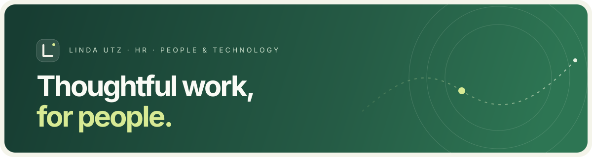

  

## Hallo, ich bin Linda

Ich arbeite im HR und über den gesamten Web-Stack hinweg: von Frontend und Nutzererlebnis bis zu Backend und APIs. Mich interessiert, wie Menschen, Gesundheit, Psychologie und Technologie im Arbeitsalltag sinnvoll zusammenspielen.

**Schwerpunkte:** HR & People · Gesundheit und Psychologie · Web · TypeScript · KI-Tools und Integrationen

Ich mag direkte Kommunikation, gut lesbare Lösungen und Interfaces, die Komplexität verständlich machen. Bei Designentscheidungen zählt mein eigener Geschmack; Designsysteme und Skills sind Inspiration und gute Ergänzung.

Building with care — for people, from the first interaction to the API behind it.

